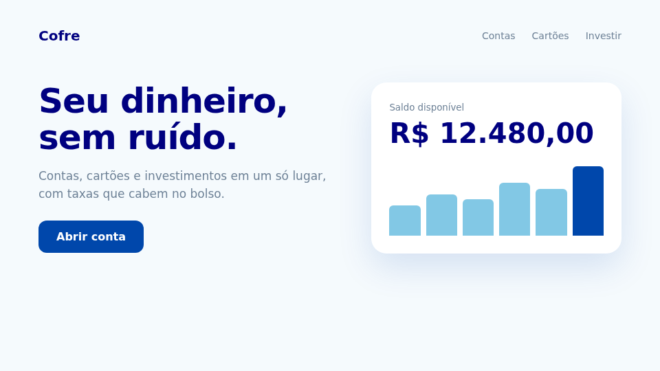
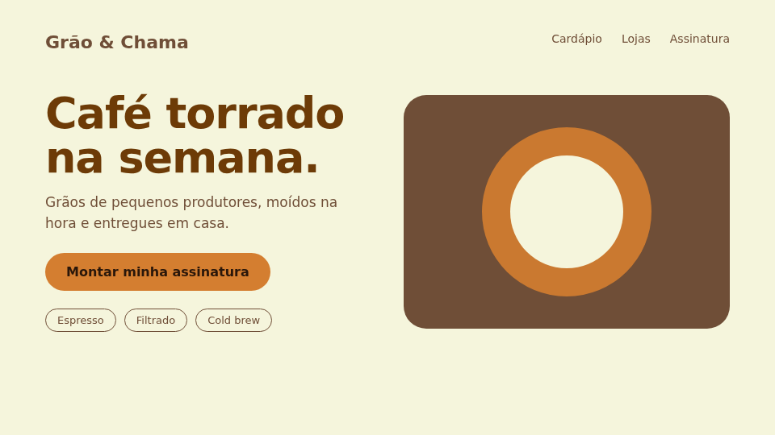
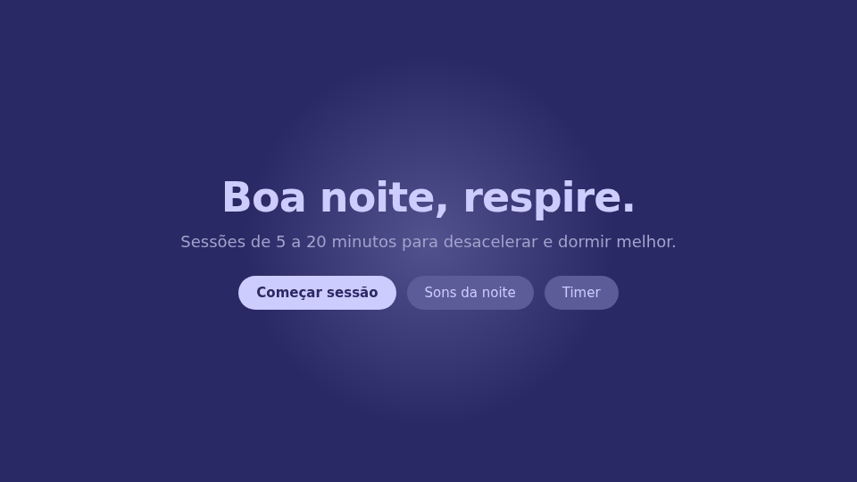
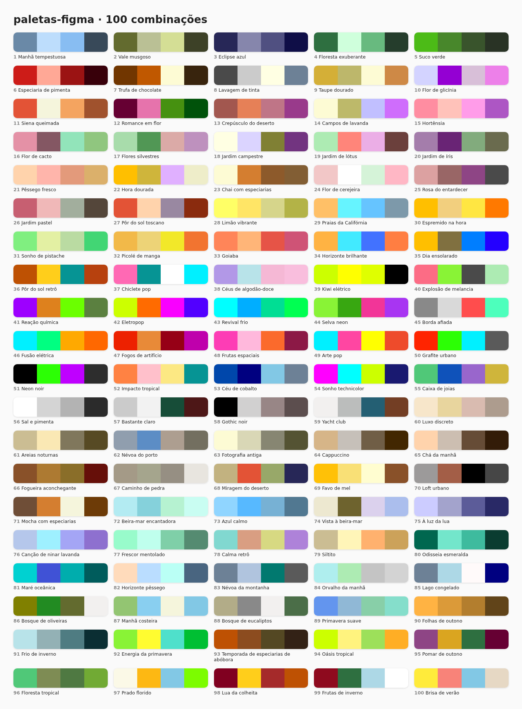

# Exemplos

Três pedidos típicos, a paleta que a skill escolhe e como distribui os papéis das cores. Os mockups estão em `examples/` (o HTML de cada um fica em `examples/src/`).

## 1. "Landing page para uma fintech"

**Paleta 53, Céu de cobalto:** `#0047AB` `#000080` `#82C8E5` `#6D8196`

| Papel | Cor | Contraste |
|---|---|---|
| Texto e títulos | `#000080` sobre fundo `#F5FAFD` | 15,2:1 |
| Botão principal | texto branco sobre `#0047AB` | 8,4:1 |
| Gráficos e destaques | `#82C8E5` | decorativo |
| Texto secundário | `#6D8196` sobre `#F5FAFD` | 3,8:1 |

O texto secundário `#6D8196` fica abaixo de 4,5:1: serve para legendas e texto grande, mas para parágrafos longos a skill escurece o tom em OKLCH, mantendo o matiz. O fundo `#F5FAFD` não vem da paleta: é um quase-branco puxado para o azul.

## 2. "Site de uma cafeteria de assinatura"

**Paleta 71, Mocha com especiarias:** `#6F4E37` `#D47E30` `#F5F5DC` `#6D3B07`

| Papel | Cor | Contraste |
|---|---|---|
| Fundo | `#F5F5DC` | |
| Títulos | `#6D3B07` | 8,3:1 |
| Texto de apoio | `#6F4E37` | 6,7:1 |
| Botão principal | `#D47E30` com texto `#2A170A` | 5,6:1 |

O laranja `#D47E30` com texto branco não passa de 4,5:1, por isso o botão leva texto quase preto, que não está na paleta.

## 3. "App de meditação, tela noturna"

**Paleta 75, À luz da lua:** `#CCCCFF` `#A3A3CC` `#5C5C99` `#292966`

| Papel | Cor | Contraste |
|---|---|---|
| Fundo | `#292966` | |
| Texto | `#CCCCFF` | 8,5:1 |
| Texto secundário | `#A3A3CC` | 5,4:1 |
| Botão principal | `#CCCCFF` com texto `#292966` | 8,5:1 |
| Botões secundários e brilho | `#5C5C99` | |

## Todas as paletas

## Como a skill decide

1. Procura pelo clima ou pelo setor na tabela (ou em "Atalhos por setor").
2. Define os papéis pela luminância: a mais escura vira texto ou fundo escuro, a mais clara vira fundo, a mais saturada vira botão ou destaque.
3. Confere o contraste e completa com quase-preto ou quase-branco quando nenhum par da paleta é legível.
4. Informa o número e o nome da paleta usada.

Os contrastes acima foram calculados pela fórmula de luminância relativa do WCAG 2.
