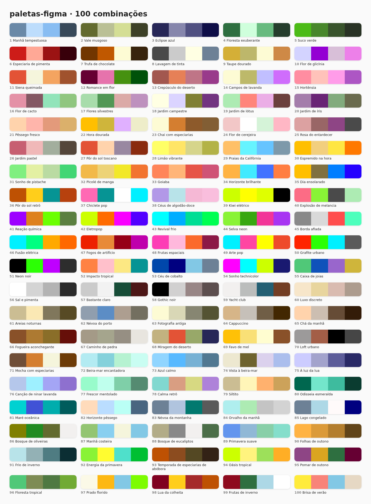

# paletas-figma

Skill do [Claude Code](https://code.claude.com/docs/en/skills) com 100 combinações de cores (4 cores cada, com HEX), o clima e o uso indicado de cada uma, mais atalhos por setor (fintech, luxo, comida, saúde, infantil...).

Serve para escolher cores de site, painel, app, logo, banner, apresentação ou vídeo quando não há um design system definido.



Veja pedidos de exemplo, a paleta escolhida e o contraste de cada papel em [EXAMPLES.md](EXAMPLES.md).

## Instalação

```bash
git clone https://github.com/dcamk/paletas-figma-skill.git
cp -r paletas-figma-skill/paletas-figma ~/.claude/skills/
```

Ou, com o skills CLI:

```bash
npx skills add dcamk/paletas-figma-skill -g
```

## Uso

No Claude Code, peça por clima ou setor:

- "Que paleta usar em um app de meditação?"
- "Monte uma paleta para uma fintech"
- "Cores para um site de cafeteria"

O Claude escolhe uma paleta do catálogo, define os papéis das cores pela luminância, confere o contraste (WCAG) e diz qual número e nome usou.

## Fonte e créditos

As combinações vêm da biblioteca de recursos do Figma: <https://www.figma.com/pt-br/resource-library/combinacoes-de-cores/> (copiadas em 05/11/2026). Os códigos HEX seguem os rótulos impressos em cada paleta. Os nomes e a curadoria pertencem ao Figma; este repositório não é afiliado nem endossado por ele.

A estrutura da skill, as instruções de uso e os atalhos por setor estão sob a licença MIT (veja `LICENSE`).
